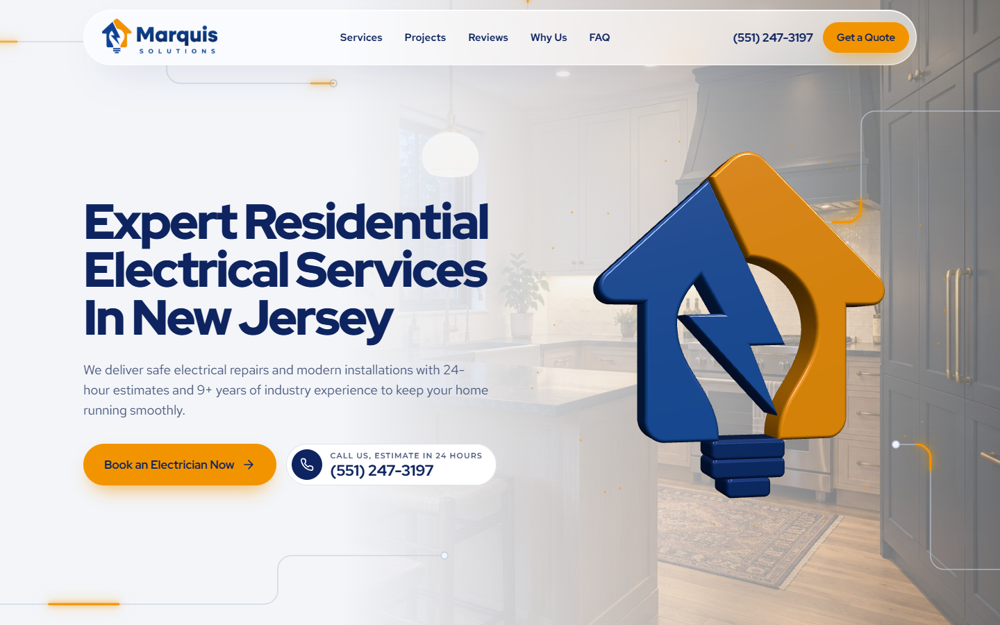
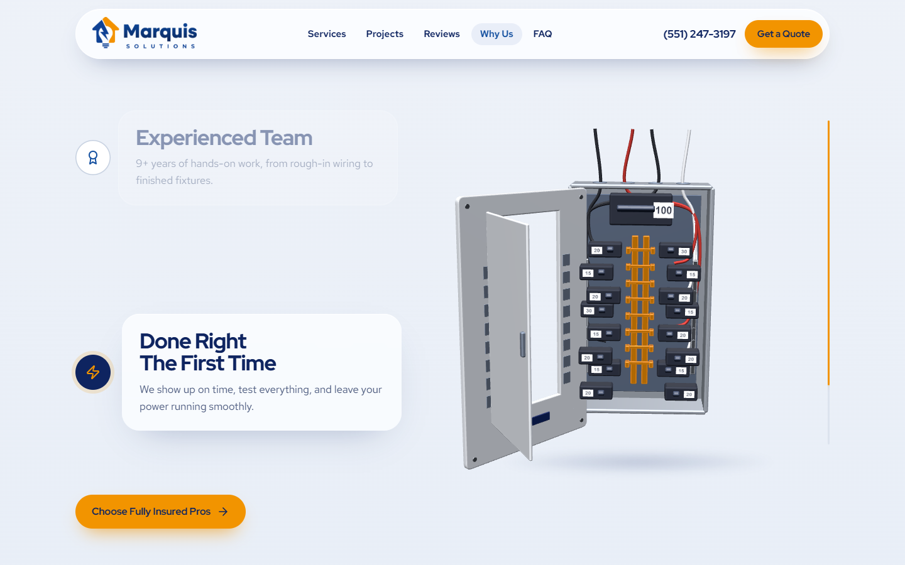
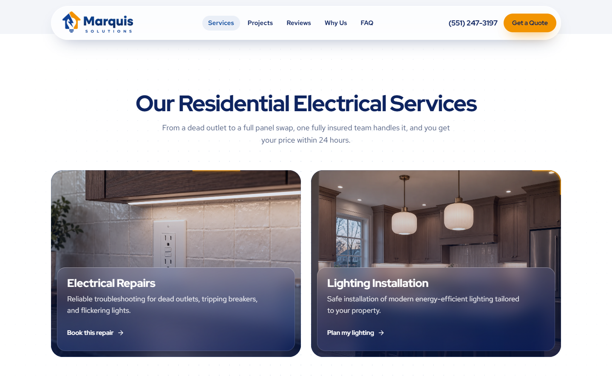

<div align="center">


### Residential Electrical Services · Newark, NJ

Site institucional one page, com foco em conversão, para a **Marquis Solutions LLC**, empresa de serviços elétricos residenciais em Newark, Belleville e região de Essex County, New Jersey.

[](#stack)
[](#stack)
[](#stack)
[](#stack)
[](#stack)
[](#deploy-na-hostinger)

[**Ambiente de teste**](https://marquis.escolats.com.br) · [**Produção**](https://marquissolutionsnj.com)

</div>

---

<p align="center">
  
</p>

## Visão geral

Página única pensada para quem chega por Google Ads, Meta Ads e Google Business Profile com um problema elétrico em casa. Cada tela oferece uma forma de agir: **ligar, mandar SMS ou pedir orçamento**.

| | |
|---|---|
| **Público** | Proprietários de imóveis em New Jersey |
| **Objetivo** | Gerar leads diretos (formulário, ligação e SMS) |
| **Idioma** | Inglês (EUA) |
| **Ambiente de teste** | `marquis.escolats.com.br` (bloqueado para o Google) |
| **Produção** | `marquissolutionsnj.com` |

## Destaques

<table>
<tr>
<td width="50%" valign="top">

### ⚡ Painel elétrico 3D com scroll
Um quadro de disjuntores modelado em Three.js que se abre em 4 camadas conforme a rolagem: a porta abre, os disjuntores saem, o barramento acende e a corrente percorre os fios. Cada camada apresenta um diferencial da empresa.

</td>
<td width="50%" valign="top">



</td>
</tr>
<tr>
<td width="50%" valign="top">



</td>
<td width="50%" valign="top">

### 🔌 Bordas com corrente elétrica
Cards de serviço em foto inteira com painel de vidro (glassmorphism). Uma corrente laranja percorre a borda arredondada: pulso lento ao entrar na tela, corrente forte com faíscas no hover. No celular, o card no centro da tela acende sozinho.

</td>
</tr>
</table>

**Também no site**

- 🏠 **Símbolo da marca em 3D** no hero, que se monta e "acende" ao carregar
- 🟠 **Status "Open now"** calculado pelo horário de New Jersey
- 📱 **Barra fixa no celular** com Call, Text e Get a Quote
- 🧭 **Faixa de cidades atendidas** em loop infinito
- ❓ **FAQ** com as dúvidas reais do cliente: custo, prazo e data do orçamento
- 🔦 **404 interativa**: o visitante "religa o disjuntor" para voltar ao início

<p align="center">
  
</p>

## Stack

| Camada | Tecnologia |
|---|---|
| Base | HTML5, CSS3 e JavaScript puros (sem build) |
| 3D | [Three.js](https://threejs.org) r160 via import map |
| Animação | [GSAP](https://gsap.com) 3.12 + ScrollTrigger · [Lenis](https://lenis.darkroom.engineering) 1.1 (scroll suave) |
| Tipografia | Red Hat Display, Red Hat Text e Montserrat (Google Fonts) |
| Formulário | [Web3Forms](https://web3forms.com) |
| Métricas | Google Analytics 4 / Google Ads e Meta Pixel (opcionais) |
| Hospedagem | Hostinger (Apache / LiteSpeed) |

### Identidade visual

| Token | Cor | Uso |
|---|---|---|
| Ice | `#F3F5F9` | Fundo principal |
| Navy | `#0E2460` | Títulos, rodapé, blocos escuros |
| Royal | `#1450A0` | Links, ícones, estrutura |
| Orange | `#F29400` | Só onde há corrente ou ação: botões, bordas, faíscas |
| Steel | `#DCE3EE` | Divisórias e linhas |

## Estrutura

```text
.
├── index.html            # página única
├── 404.html              # página de erro interativa
├── .htaccess             # HTTPS, URLs sem .html, cache, segurança, noindex no teste
├── robots.txt            # produção: liberado + sitemap
├── robots-staging.txt    # teste: bloqueia tudo (servido pelo .htaccess)
├── sitemap.xml
├── assets/
│   ├── css/styles.css
│   ├── js/
│   │   ├── main.js         # navegação, formulários, rastreamento, bordas elétricas
│   │   ├── hero-symbol.js  # símbolo 3D do hero
│   │   ├── panel-scene.js  # painel elétrico 3D com scroll
│   │   └── brand-shapes.js # geometria do logo usada pelas cenas 3D
│   ├── img/                # fotos (WebP) + origem de cada imagem em .json
│   └── logo/
└── docs/                   # imagens deste README
```

## Rodando localmente

O site usa módulos ES (import map do Three.js), então precisa de um servidor. Abrir o `index.html` direto no navegador não carrega o 3D.

```bash
# qualquer uma das opções
npx serve .
python -m http.server 8000
```

Depois acesse `http://localhost:3000` (ou `:8000`).

## Configuração

Todas as chaves ficam no topo de [`assets/js/main.js`](assets/js/main.js):

```js
const CONFIG = {
  WEB3FORMS_KEY: 'YOUR_WEB3FORMS_ACCESS_KEY', // sem a chave, o formulário roda em modo demo
  GA_ID: '',          // G-XXXXXXXXXX ou AW-XXXXXXXXX
  META_PIXEL_ID: '',  // 123456789012345
  TIMEZONE: 'America/New_York',
  OPEN_HOUR: 8,
  CLOSE_HOUR: 18,
};
```

Eventos de conversão já disparados:

| Ação | GA4 / Google Ads | Meta Pixel |
|---|---|---|
| Envio de formulário | `generate_lead` | `Lead` |
| Clique em ligar | `click_to_call` | `Contact` |
| Clique em SMS | `click_to_text` | `Contact` |

## Deploy na Hostinger

Enviar para a pasta pública do domínio:

```text
index.html  404.html  assets/  .htaccess  robots.txt  robots-staging.txt  sitemap.xml
```

> O `.htaccess` é um arquivo oculto. Ative "mostrar arquivos ocultos" no Gerenciador de Arquivos.

O mesmo pacote funciona nos dois ambientes, sem editar nada:

| | Teste | Produção |
|---|---|---|
| Domínio | `marquis.escolats.com.br` | `marquissolutionsnj.com` |
| Google | Bloqueado (`X-Robots-Tag: noindex` + robots que bloqueia tudo) | Liberado, com sitemap |
| HTTPS | Forçado | Forçado, `www` vai para sem `www` |

**URLs limpas:** `/pagina.html` redireciona (301) para `/pagina` e `/index.html` para `/`. Uma página nova funciona criando `pagina.html` e linkando como `/pagina`.

## Qualidade

- **Responsivo** e testado em 360, 390, 768, 1024, 1280 e 1920 px, sem rolagem horizontal
- **Acessibilidade:** contraste AA, foco visível, áreas de toque de 44 px no celular, `prefers-reduced-motion` desliga as animações e o 3D vai direto ao estado final
- **SEO local:** schema `Electrician` com endereço, horário e cidades atendidas, Open Graph, canonical e sitemap
- **Performance:** imagens WebP com lazy load, cenas 3D só renderizam quando estão na tela, compressão e cache pelo `.htaccess`

---

<div align="center">

Desenvolvido por **[Eu Sou TS](https://eusouts.com.br/)**

<sub>© Marquis Solutions LLC. Todos os direitos reservados. Projeto proprietário, uso não autorizado.</sub>

</div>
